<div align="center">


<a href="https://github.com/TromBoloN">
  
</a>

<br/>


</div>

---

## 🖥️ `whoami`

```bash
$ whoami
> arif_abdurrahman_siddiq

$ cat about.txt
> Student developer from East Kalimantan, Indonesia
> Into backend development, maps (WebGIS) and Python
> Designed the database and Django backend of a digital food ordering system
> Now building full-stack with Next.js + Supabase

$ ls ./skills
> django/  python/  rest-api/  webgis/  nextjs/  supabase/  frontend/

$ echo $CURRENTLY_WORKING_ON
> MIT-WEEK 2026 competition portal 🏆

$ echo $STATUS
> building in public 🚀
```

---

## 🛠️ Tech Stack

| Category | Technologies & Tools |
| :-- | :-- |
| **Languages** |        |
| **Frontend** |       |
| **Backend & Database** |        |
| **WebGIS & Data** |      |
| **Tools & Environment** |     |

---

## 🚀 Featured Projects

<table>
  <tr>
    <td width="50%" valign="top">
      <h3>🏆 <a href="https://github.com/TromBoloN/web-submissions">MIT-WEEK 2026 Portal</a></h3>
      <p><b>Web Development Competition Platform</b></p>
      <p>Official portal for the Web Development Competition at MIT-WEEK 2026 (Informatics Association, Universitas Mulawarman). Contestants submit their work, judges score it blind against a weighted rubric, and the committee runs everything from one admin panel. Row Level Security and database triggers lock scores once results are released.</p>
      <p>
        
        
        
        
        
      </p>
      <p>🔗 <a href="https://github.com/TromBoloN/web-submissions"><b>Repository ➔</b></a></p>
    </td>
    <td width="50%" valign="top">
      <h3>🍽️ <a href="https://github.com/Cordova88/pemesanan-makanan-digital">Pemesanan Makanan Digital</a></h3>
      <p><b>Digital Food Ordering System</b></p>
      <p>Customers order by scanning a QR code at their table, and the cashier panel handles payments, cancellations and refunds. A rule-based Indonesian chatbot picks up preferences and moods, then ranks menu items. I designed the whole database and wrote the Django backend.</p>
      <p>
        
        
        
        
      </p>
      <p>🔗 <a href="https://github.com/Cordova88/pemesanan-makanan-digital"><b>Repository ➔</b></a></p>
    </td>
  </tr>
  <tr>
    <td width="50%" valign="top">
      <h3>🗺️ <a href="https://github.com/hissyam90/webgis-kaltim">WebGIS Kaltim</a></h3>
      <p><b>Power Plant Map of Kalimantan</b></p>
      <p>Team project (Kelompok Green Hosa, Universitas Mulawarman) that maps power plants across Kalimantan. Leaflet markers by plant type, a basemap switcher, a choropleth of East Kalimantan regencies by renewable share, plus search, filters and CSV export.</p>
      <p>
        
        
        
        
        
      </p>
      <p>🔗 <a href="https://github.com/hissyam90/webgis-kaltim"><b>Repository ➔</b></a></p>
    </td>
    <td width="50%" valign="top">
      <h3>🧾 Backend Modules</h3>
      <p><b>What I built in the food ordering system</b></p>
      <p>
        <code>orders</code>: checkout, price snapshots, order status, payments, cancellations and refunds<br/><br/>
        <code>menu</code>: categories, items, variants, add-ons and tags<br/><br/>
        <code>recommendation</code>: chatbot that extracts preferences and moods, then ranks menu items<br/><br/>
        <code>users</code>: staff login and cashier/admin management
      </p>
    </td>
  </tr>
</table>

---

## 📊 Dev Stats

<div align="center">



<sub>Generated by my own <a href="./scripts/generate_stats_card.py">Python script</a> using the GitHub API, so it counts work in other people's repos too.</sub>

</div>

---

## 👾 Contribution Pac-Man

<div align="center">

<picture>
  <source media="(prefers-color-scheme: dark)" srcset="https://raw.githubusercontent.com/TromBoloN/TromBolon/output/pacman-contribution-graph-dark.svg">
  <source media="(prefers-color-scheme: light)" srcset="https://raw.githubusercontent.com/TromBoloN/TromBolon/output/pacman-contribution-graph.svg">
  
</picture>

</div>

---

