<div align="center">



</div>

> **NOTICE.** This record is retained by the Directorate of Civic Records, Sector 64.
> Contents are accurate as of the last audit. Discrepancies should not be reported.

### § I — SUBJECT SUMMARY <sub><code>REF/CR-64-01</code></sub>

```text
DESIGNATION ........ ARIF_ABDURRAHMAN_SIDDIQ
ORIGIN ............. EAST KALIMANTAN, INDONESIA
CLASSIFICATION ..... STUDENT DEVELOPER
KNOWN ACTIVITY ..... BACKEND DEVELOPMENT. USUALLY BUILDS FOR THE WEB.
CURRENT ASSIGNMENT . MIT-WEEK 2026 COMPETITION PORTAL
CURRENT TRAINING ... SYSTEM ARCHITECTURE
OBSERVED HABITS .... BUILDS IN PUBLIC. CONTINUES TO LEARN.
PRIOR AFFILIATION .. ████████████
PSYCH EVALUATION ... ██████ ██ ████
```

### § II — CERTIFIED COMPETENCIES <sub><code>REF/CR-64-02</code></sub>



### § III — CASE FILES <sub><code>REF/CR-64-03</code></sub>

<a href="https://github.com/TromBoloN/web-submissions"></a>
<a href="https://github.com/Cordova88/pemesanan-makanan-digital"></a>
<a href="https://github.com/hissyam90/webgis-kaltim"></a>

### § IV — ACTIVITY LEDGER <sub><code>REF/CR-64-04</code></sub>



<sub>Compiled daily by the subject's own <a href="./scripts/generate_stats_card.py">Python script</a> via the GitHub API. Work filed in other people's repositories is counted.</sub>

### § V — ATTENDANCE REGISTER <sub><code>REF/CR-64-05</code></sub>




