<div align="center">


<a href="https://github.com/TromBoloN">
  
</a>

<br/>


</div>

---

## 🖥️ `whoami`

```bash
$ whoami
> arif_abdurrahman

$ cat about.txt
> Student developer from East Kalimantan, Indonesia
> Into backend development, maps (WebGIS) and Python
> Built the Django backend of a digital food ordering system

$ ls ./skills
> django/  python/  rest-api/  webgis/  frontend/

$ echo $CURRENTLY_WORKING_ON
> upgrading the recommendation chatbot 🤖

$ echo $STATUS
> building in public 🚀
```

---

## 🛠️ Tech Stack

| Category | Technologies & Tools |
| :-- | :-- |
| **Languages** |       |
| **Frontend** |     |
| **Backend & Database** |       |
| **WebGIS & Data** |      |
| **Tools & Environment** |     |

---

## 🚀 Featured Projects

<div align="center">

<a href="https://github.com/Cordova88/pemesanan-makanan-digital">
  
</a>
<a href="https://github.com/hissyam90/webgis-kaltim">
  
</a>

</div>

**🍽️ Pemesanan Makanan Digital** is a Django food ordering app with QR table ordering, a cashier panel and an Indonesian recommendation chatbot.

| Module | What I built |
| :-- | :-- |
| 🧾 `orders` | Checkout, price snapshots, order status, payments, cancellations and refunds |
| 📋 `menu` | Categories, items, variants, add-ons and tags |
| 🤖 `recommendation` | Rule-based chatbot that extracts preferences and moods, then ranks menu items |
| 👤 `users` | Staff login and cashier/admin management |

🔧 **Next up:** upgrading the chatbot.

<br/>

**🗺️ WebGIS Kaltim** is a team project (Kelompok Green Hosa, Universitas Mulawarman) that maps power plants across Kalimantan.

| Area | Details |
| :-- | :-- |
| 🌍 Interactive map | Leaflet markers by plant type, basemap switcher (Dark, OSM, Satellite) |
| 📊 Regional analysis | Choropleth of East Kalimantan regencies by renewable share and dominant energy type |
| 🔎 Search & filters | Real-time search, plant-type and region filters, CSV export |
| ⚙️ Stack | React + Vite + Tailwind frontend, FastAPI + PostgreSQL backend |

---

## 📊 Dev Stats

<div align="center">



<sub>Generated by my own <a href="./scripts/generate_stats_card.py">Python script</a> using the GitHub API, so it counts work in other people's repos too.</sub>

</div>

---

## 🧊 3D Contribution Graph

<div align="center">


</div>

---

## 👾 Contribution Pac-Man

<div align="center">

<picture>
  <source media="(prefers-color-scheme: dark)" srcset="https://raw.githubusercontent.com/TromBoloN/TromBolon/output/pacman-contribution-graph-dark.svg">
  <source media="(prefers-color-scheme: light)" srcset="https://raw.githubusercontent.com/TromBoloN/TromBolon/output/pacman-contribution-graph.svg">
  
</picture>

</div>

---

