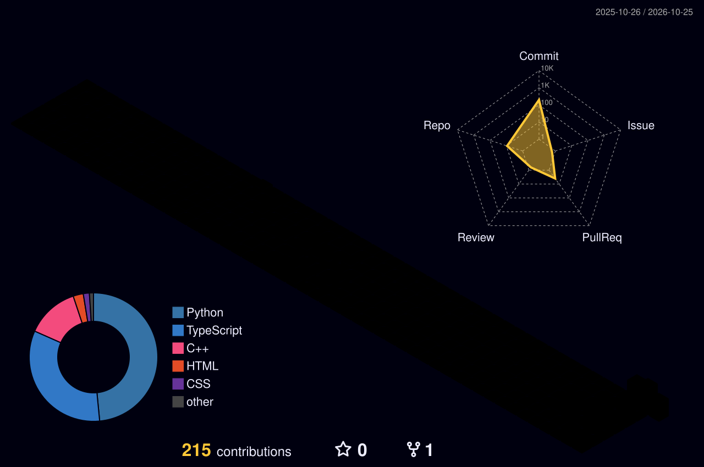

<div align="center">


<a href="https://github.com/TromBoloN">
  
</a>

<br/>


</div>

---

## 🖥️ `whoami`

```bash
$ whoami
> arif_abdurrahman

$ cat about.txt
> Student developer from East Kalimantan, Indonesia
> Trying web development

$ ls ./skills
> django/  python/  rest-api/  webgis/  frontend/ laravel/

$ echo $CURRENTLY_WORKING_ON
> upgrading the recommendation chatbot 🤖

$ echo $STATUS
> building in public 🚀
```

---

## ⚡ Tech Stack

<div align="center">


</div>


---

## 🚀 Featured Project

<div align="center">

<a href="https://github.com/Cordova88/pemesanan-makanan-digital">
  
</a>

</div>

**🍽️ Pemesanan Makanan Digital** is a Django food ordering app with QR table ordering, a cashier panel and an Indonesian recommendation chatbot.

| Module | What I built |
| :-- | :-- |
| 🧾 `orders` | Checkout, price snapshots, order status, payments, cancellations and refunds |
| 📋 `menu` | Categories, items, variants, add-ons and tags |
| 🤖 `recommendation` | Rule-based chatbot that extracts preferences and moods, then ranks menu items |
| 👤 `users` | Staff login and cashier/admin management |

🔧 **Next up:** upgrading the chatbot.

---

## 📊 GitHub Stats

<div align="center">


<br/>


</div>

---

## 🧊 3D Contribution Graph

<div align="center">



</div>

---

## 🐍 Contribution Snake

<div align="center">


</div>

---

